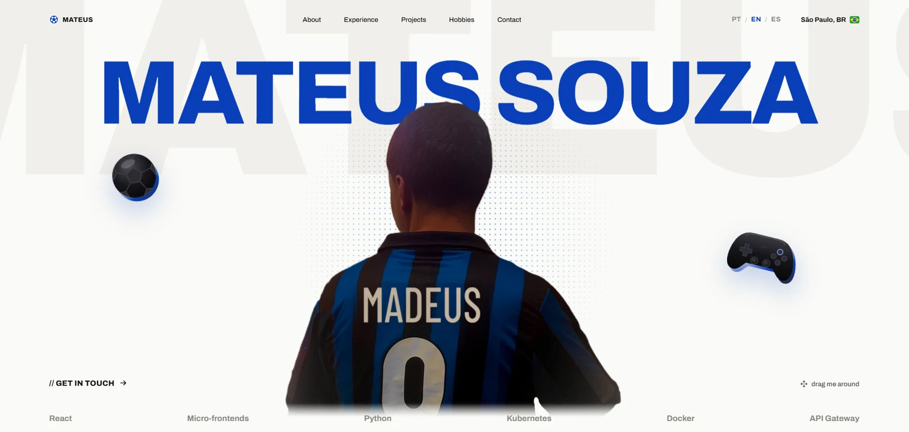

# Mateus Souza — Portfolio

Personal portfolio of Mateus Souza, a front-end and fullstack engineer based in São Paulo, Brazil.

**Live at [madeusdev.com](https://madeusdev.com)**



## Highlights

- **Throwable toys with hand-rolled physics.** The football and the controller live on the whole page: drag them, throw them, watch them bounce off the edges and collide with each other. The page auto-scrolls while you drag near the viewport edge. No physics library, just `requestAnimationFrame` writing transforms straight to the DOM, so nothing re-renders.
- **i18n in Portuguese, English and Spanish, without a library.** Every string lives in a typed dictionary, so a missing translation fails the build. The initial language comes from the saved choice, then the browser, then English.
- **FUT-style hobby cards.** A shield shape made from a stretched SVG mask, a 3D flip, and media on the back that only downloads after the first flip.
- **Light media.** GIFs are converted to muted, looping MP4s, roughly 30x smaller.
- **Accessible by default.** Respects `prefers-reduced-motion`, decorative elements are hidden from screen readers, and interactive controls have proper labels and pressed states.

## Stack

Vite · React 18 · TypeScript · plain CSS (design tokens in `:root`, no framework) · [Phosphor Icons](https://phosphoricons.com/) · Prettier · Yarn 1 · hosted on Cloudflare Pages

## Getting started

```bash
yarn            # install (Node 22, see .node-version)
yarn dev        # http://localhost:3000
yarn build      # type-check + production build
yarn format     # prettier
```

## Project structure

```
src/
  App.tsx                  section order + page-wide toy layer
  i18n/                    pt.ts, en.ts, es.ts (typed by types.ts) + provider
  data/content.ts          language-independent data: links, stack, media, card stats
  hooks/usePhysicsToys.ts  drag, throw, bounce and collision physics
  components/              one component per section, plus toys and the language switch
  styles/global.css        tokens and per-section styles
public/images/             photos, videos and project screenshots
```

To change any text, edit the dictionaries in `src/i18n/`. To change links, stack chips, card stats or media, edit `src/data/content.ts`.

## Deploy

Cloudflare Pages builds every push to `main` (`yarn build`, output `dist`). Security headers and caching rules live in [`public/_headers`](public/_headers).

## Adding a GIF

GIFs are converted to MP4 before going into `public/images/`. Keep the original in `media-src/`, which is git-ignored:

```bash
ffmpeg -i clip.gif -an -c:v libx264 -preset slow -crf 26 -pix_fmt yuv420p \
  -movflags +faststart -vf "scale='min(480,iw)':-2:flags=lanczos,fps=24" public/images/clip.mp4
```

## Credits

- Icons: [Phosphor Icons](https://github.com/phosphor-icons/react) (MIT)
- Brazil flag: [flag-icons](https://github.com/lipis/flag-icons) (MIT)
- The Corinthians crest belongs to Sport Club Corinthians Paulista and is used here only as a personal fan reference.
